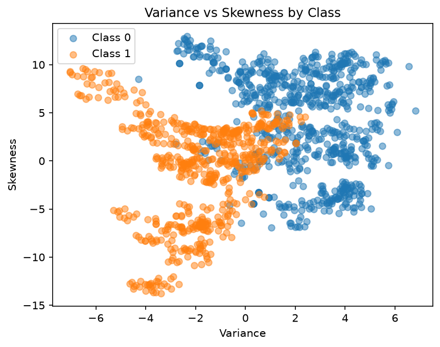

# Banknote Authentication with k-Nearest Neighbors from Scratch

A machine learning project focused on implementing and evaluating the **k-Nearest Neighbors (kNN)** classification algorithm from scratch.

The goal of the project is to classify banknote observations using numerical features extracted from banknote images, while implementing the main machine learning workflow without using a ready-made classifier from libraries such as scikit-learn.

## Project Overview

The project covers the complete basic machine learning workflow:

- exploratory data analysis,
- train / validation / test splitting,
- feature standardization,
- baseline evaluation,
- implementation of Euclidean distance,
- implementation of kNN from scratch,
- hyperparameter selection,
- final model evaluation,
- calculation of classification metrics.

The main purpose of the project is not only to obtain good classification performance, but also to understand how the individual components of a classification pipeline work.

## Dataset

The project uses the **Banknote Authentication** dataset from the UCI Machine Learning Repository.

The dataset contains **1,372 observations** and four numerical features:

- `variance`
- `skewness`
- `curtosis`
- `entropy`

The target variable is:

- `class`

There are no missing values in the dataset.

The features were extracted from images of genuine and forged banknote-like specimens using wavelet-based image processing.

Dataset citation:

**Lohweg, V. (2012). Banknote Authentication. UCI Machine Learning Repository. DOI: 10.24432/C55P57**

## Exploratory Data Analysis

The exploratory analysis shows noticeable differences between the two target classes.

In particular, `variance` and `skewness` provide strong separation between the classes, while `curtosis` also contains useful information. `entropy` appears less informative when considered individually.

However, all four features are retained because a feature with weaker individual separation may still contribute useful information when combined with other variables.

## Data Splitting

The dataset is divided manually into three subsets:

- **70% training set**
- **15% validation set**
- **15% test set**

The split is performed separately for each target class in order to preserve similar class proportions across all subsets.

A fixed random seed is used to make the split reproducible.

The test set remains unused during model development and hyperparameter selection.

## Baseline Classifier

Before evaluating kNN, a simple majority-class baseline is established.

The baseline always predicts the most frequent